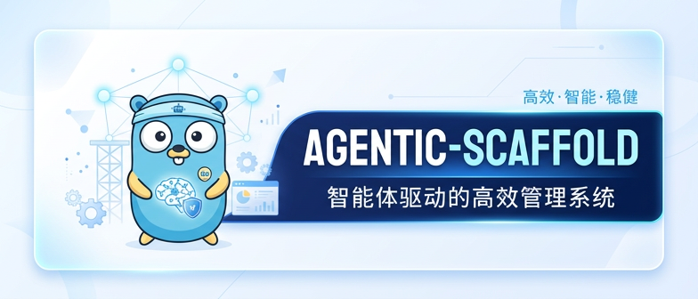

# Agentic-Scaffold-UI

- **GitHub 地址**：<https://github.com/HandsomeNPC/Agentic-Scaffold-UI>
- **Gitee 地址**：<https://gitee.com/handsome-npc/agentic-scaffold-ui>
- **后端项目**：<https://github.com/HandsomeNPC/Agentic-Scaffold-Backend>
- **在线文档**：<https://agentic-scaffold-doc.chenziwen.top>

<p align="center">
  
</p>

<p align="center">
  <a href="https://github.com/HandsomeNPC/Agentic-Scaffold-UI/stargazers">
    
  </a>
  
  
  
  
  
  
</p>

> 如果这个项目对你有帮助，欢迎点个 ⭐ 让更多人看到，也欢迎 [承接定制开发 / 私有化部署](#承接定制开发)。

> 本仓库基于 [TDesign Vue Next Starter](https://github.com/Tencent/tdesign-vue-next-starter) 改造，
> 业务页面与鉴权骨架对齐 [RuoYi-Vue-Plus](https://gitee.com/dromara/RuoYi-Vue-Plus) 的
> [plus-ui](https://gitee.com/JavaLionLi/plus-ui)，致敬 TDesign 团队、「疯狂的狮子Li」及若依开源社区。

## 项目介绍

**智能体驱动的高效管理系统（前端）。** 在一套完整的 RuoYi 后台（用户 / 角色 / 菜单 / 部门 / 字典 / OSS / 监控……）上，
挂一个全局常驻的 **AI 对话侧边栏**：Agent 能查数据、能跳菜单、能改界面设置，敏感操作先弹确认卡片，用户批准后才执行。

- **后端项目**：[Agentic-Scaffold-Backend](https://github.com/HandsomeNPC/Agentic-Scaffold-Backend)（Go + Gin + Eino ADK）
- **技术栈**：Vue 3.5、Vite 8、TypeScript、Pinia、Vue Router、vue-i18n、[TDesign Vue Next](https://tdesign.tencent.com/vue-next/overview)
- **对话组件**：[@tdesign-vue-next/chat](https://tdesign.tencent.com/chat/overview)，以 `agui` 协议直连后端 SSE

## ✨ 亮点

| 能力                 | 说明                                                                                          |
|----------------------|-----------------------------------------------------------------------------------------------|
| **全局对话侧边栏**   | 任何页面右侧常驻；收起只是隐藏，对话与 SSE 连接照常进行；无 `ai:thread:chat` 权限的用户不显示      |
| **AG-UI 流式渲染**   | 文本与工具调用逐帧渲染；新消息可抢占正在进行的一轮                                               |
| **工具卡片**         | 每个后端工具对应一个 Vue 卡片组件（`src/agent/components/tools/`），按工具名自动匹配               |
| **人在回路 (HITL)**  | 发公告、改角色、启停用户等操作由卡片承载「批准 / 拒绝」，刷新页面后待确认卡片仍可恢复              |
| **前端动作工具**     | 跳转菜单、切换主题 / 布局 / 尺寸、开关全屏、读取当前打开的标签页——Agent 直接操作界面               |
| **会话管理与附件**   | 多会话切换、历史恢复、自动标题；图片 / 文件附件（后端开启时显示上传按钮）                          |
| **RuoYi 后台全家桶** | 登录（含 RSA 请求加密）、动态路由、按钮级权限、系统管理与系统监控页面                            |

## 环境准备

- **Node.js 22.12+**（`package.json` 的 `engines` 已限定）
- 已启动的 [Agentic-Scaffold-Backend](https://github.com/HandsomeNPC/Agentic-Scaffold-Backend)，默认 `http://localhost:8080`

## 项目启动

```bash
# 安装依赖（国内网络可先 npm config set registry https://registry.npmmirror.com）
npm install

# 启动开发服务器（默认端口见 .env.development 的 VITE_APP_PORT）
npm run dev
```

开发环境下 `/dev-api` 会经 vite 代理转发到 `VITE_API_URL`（默认 `http://localhost:8080`），SSE 与 WebSocket 同样走代理。
种子账号 `admin / admin123`。

### 常用命令

```bash
npm run build          # 类型检查 + 生产构建（产物在 dist/）
npm run build:test     # 测试环境构建
npm run preview        # 本地预览构建产物
npm run dev:mock       # 不连后端，使用 mock/ 下的本地数据
npm run lint           # ESLint 检查
npm run lint:fix       # ESLint 自动修复
npm run stylelint      # 样式检查
```

## 配置说明

| 文件               | 作用                                                                  |
|--------------------|-----------------------------------------------------------------------|
| `.env`             | 公共配置：标题、请求加密开关与 RSA 密钥、客户端 ID、消息推送方式        |
| `.env.development` | 开发：接口前缀 `/dev-api`、后端地址 `VITE_API_URL`、端口               |
| `.env.production`  | 生产：接口前缀 `/prod-api`（由 nginx 转发到后端）                      |
| `.env.test`        | 测试：接口前缀 `/stage-api`                                            |

**前后端必须同步的两项：**

- `VITE_APP_ENCRYPT`：登录 / 改密 / 重置密码的请求加密开关，后端 `apiEncrypt.enabled` 同步开关，只改一边会 403。
- `VITE_APP_RSA_PUBLIC_KEY`：当前为 RuoYi 上游公开的示例密钥，**上线前务必更换**，并同步后端 `apiEncrypt.privateKey`。

### 生产部署（nginx 示例）

```nginx
location / {
    root   /usr/share/nginx/html;
    try_files $uri $uri/ /index.html;
}

location /prod-api/ {
    proxy_pass http://127.0.0.1:8080/;   # 单体后端；多模块时按 /auth /system /ai 等前缀分流
    proxy_set_header Host $host;
    proxy_http_version 1.1;
    proxy_buffering off;                  # AI 对话走 SSE，关闭缓冲
    proxy_read_timeout 600s;
}
```

## 新增一个工具卡片

后端新增工具后，前端只需两步，中断恢复链路无需改动：

1. 在 `src/agent/components/tools/` 下新建卡片组件（可参考 `demo/DemoToolCard.vue` 的确认范式）。
2. 在 `src/agent/components/tools/register.ts` 的 `toolcallActions` 中登记，`name` 与后端工具名一致。

## 目录结构

```
src/
  agent/                  智能体前端
    api/                  会话 / 消息 / 附件接口与类型
    components/           AgentSideBar（全局侧边栏）、AgentPanel、Header、Sender
      tools/              工具卡片：demo/（HITL 示例）、system/（系统管理类）、register.ts
  api/                    RuoYi 后台接口
  layouts/                整体布局（侧边栏在 layouts/index.vue 挂载）
  pages/                  system/、monitor/、tool/ 等业务页面
  store/                  Pinia：用户、权限、设置、标签页
  router/                 静态路由 + 基于权限的动态路由
  utils/                  请求封装（含加密）、权限判断等
mock/                     dev:mock 模式的本地数据
```

## 赞助作者

作者为兼职做开源，平时还需要工作，如果帮到了您可以请作者吃个盒饭。

<table>
  <tr>
    <td align="center"><br/>微信</td>
    <td align="center"><br/>支付宝</td>
  </tr>
</table>

## 开源协议

本项目基于 [MIT License](LICENSE) 开源，转载 / 二次开发请注明原作者与出处。
项目部分代码源自 [TDesign Vue Next Starter](https://github.com/Tencent/tdesign-vue-next-starter)（MIT），
其版权声明按协议要求保留在 [LICENSE](LICENSE) 末尾的第三方声明中。

## 承接定制开发

作者承接基于本项目或类似后台 / 智能体系统的：

- **私有化部署**：内网/云上部署、模型接入、配置调优
- **二次开发**：业务 Agent 与工具卡片定制、页面定制、接口对接
- **全新定制**：从零搭建后台系统、智能体平台

需求描述越具体报价越准。详见 [个人网站 · 商务合作](https://chenziwen.top/about)。

## 联系方式

- 🌐 个人网站：<https://chenziwen.top>
- 📧 邮箱：<401030526@qq.com>
- 💬 QQ：401030526
- 🐙 GitHub：[@HandsomeNPC](https://github.com/HandsomeNPC)

## 作者其它项目

本仓库是作者作品集的一部分，更多开源作品与文章见 [chenziwen.top/projects](https://chenziwen.top/projects/)。

- [RuoYi-Go-Vue-Plus](https://github.com/HandsomeNPC/RuoYi-Go-Vue-Plus)：RuoYi-Vue-Plus 的 Go (Gin) 重写版
- [RuoYi-Plus-UI-TDesign](https://github.com/HandsomeNPC/RuoYi-Plus-UI-TDesign)：使用 TDesign 重写的 RuoYi 前端
- [EinoKit](https://github.com/HandsomeNPC/EinoKit)：基于 Eino ADK 的智能体工具箱
